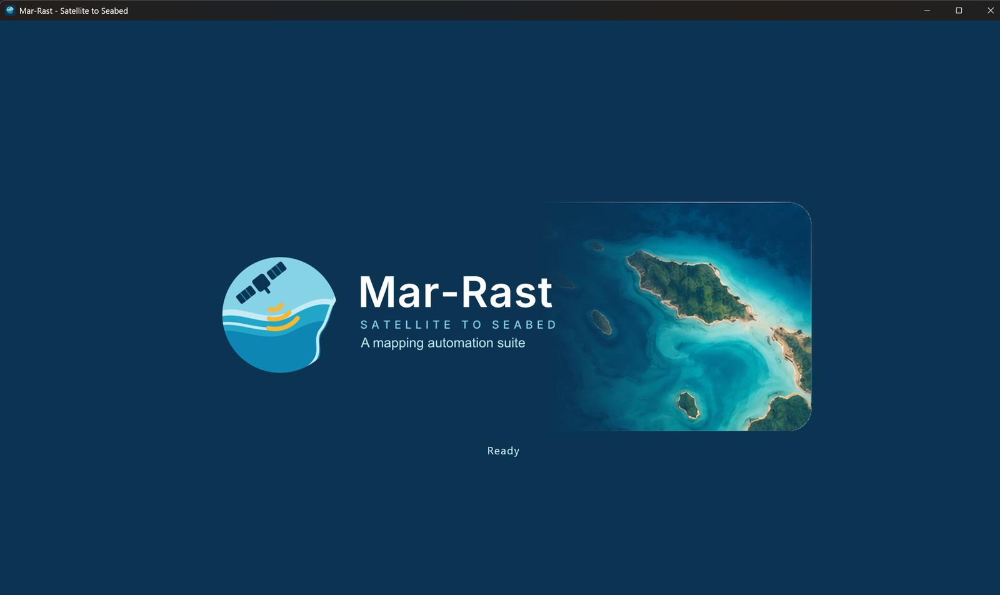
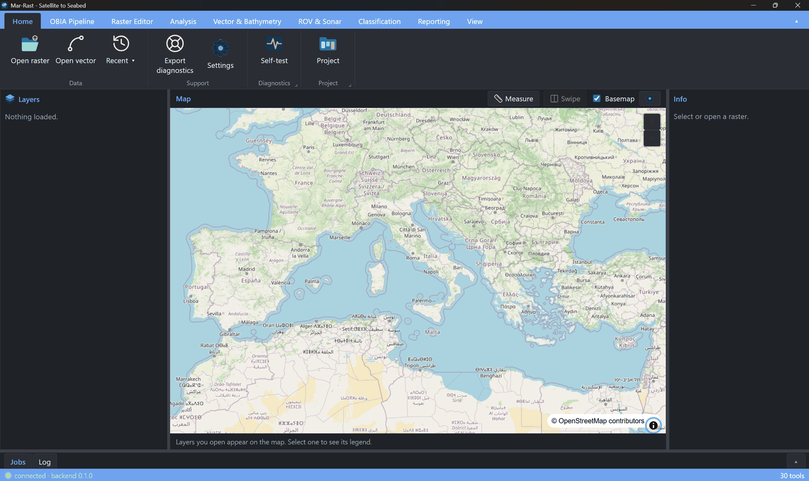
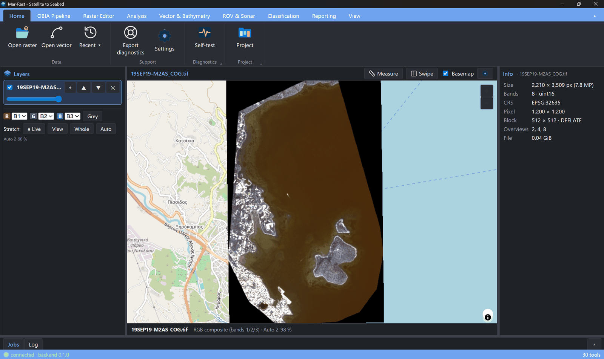
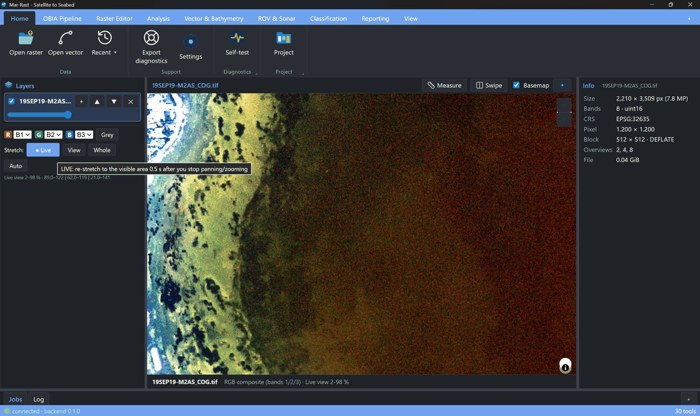
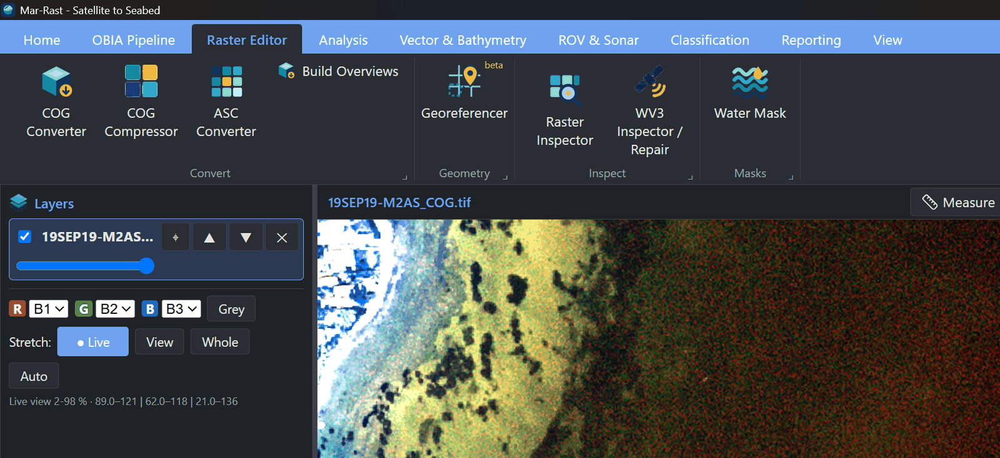
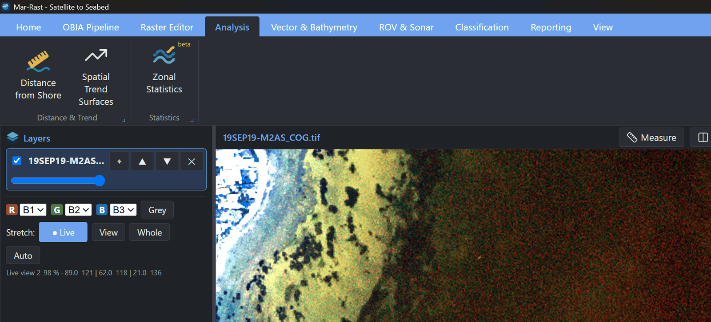
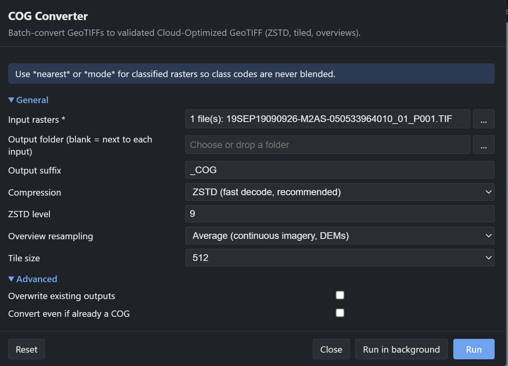
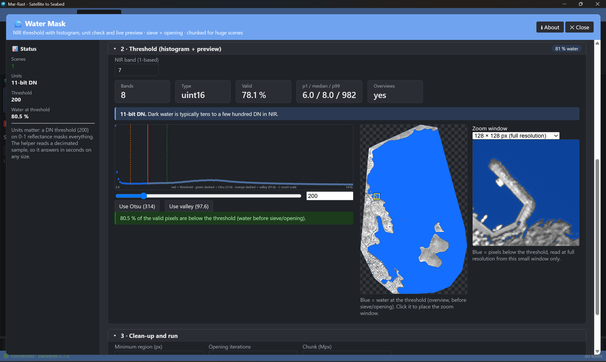

# Mar-Rast: interface preview

Mar-Rast ("Satellite to Seabed") is a desktop application (Tauri 2, React/TypeScript front end, Python processing back end) that brings the project's raster and field-data tools into a single offline-first interface for non-specialist users. It handles very large rasters (WorldView-3 scenes up to millimetre-resolution underwater photomosaics of tens of GB) with windowed processing, and chains the steps from field logs and photos to OBIA habitat classification and reporting.

The images below show the current development build. **The software is not released yet; it will be made available together with the standalone publication.**

## 1. Start-up and main window

**Splash screen.** Loads the Python back end; this can take a few seconds up to a minute depending on the machine.

**Main window.** A tabbed ribbon (Home, OBIA Pipeline, Raster Editor, Analysis, Vector & Bathymetry, ROV & Sonar, Classification, Reporting, View) over a layer list, map with basemap, measure and swipe tools, an info panel, and a jobs/log drawer. The status bar shows the back-end connection and tool count (30). Tools are registered from manifests, so new ones need no interface code.

## 2. Viewing rasters

**Plain GeoTIFF.** The Info panel reports size, bands, CRS, pixel size, block layout and overviews. Here it flags a strip-organised file with no overviews and offers to open the COG Converter prefilled.

**Cloud-Optimized GeoTIFF.** After conversion the same scene is tiled (512 px) with overviews (2, 4, 8) and is a quarter of the size on disk. Band assignment (R/G/B or grey) and stretch (Live, View, Whole, Auto) are set per layer.

**Live stretch.** Re-stretches contrast to the visible area shortly after panning or zooming.

**Multi-band rasters.** Any bands can be mapped to RGB, shown here on a 6-band float32 backscatter/synthetic raster (0.30 m pixels).

## 3. Tool ribbons

| Tab | Tools |
|---|---|
| **Raster Editor** | COG Converter, COG Compressor, ASC Converter, Build Overviews; Georeferencer (beta); Raster Inspector, WV3 Inspector / Repair; Water Mask |
| **Analysis** | Distance from Shore, Spatial Trend Surfaces; Zonal Statistics (beta) |
| **Vector & Bathymetry** | Bathymetry Interpolator; Coastline Extractor (beta); DWG/DXF to GeoPackage (beta) |
| **ROV & Sonar** | Frame Extractor, Photo Georef, CLAHE Preprocessor, Metashape EXIF Injector; SonarView .svlog to GPX, FIFISH Log Suite, GPS Merge & Interpolate |
| **Classification** | Implementator (train + classify), OBIA Segmenter (beta), Optimal Split Finder, Model Optimizer, Rasterize Habitat Map (beta), Statistics Extractor |

## 4. Guided OBIA pipeline

One tab lists the whole workflow in order, from raw data to habitat map:

1. **Digital data processing:** project, georeferencing, water mask, coastline, distance from shore, DWG/DXF import, bathymetry, trend surfaces, OBIA segmenter, zonal statistics.
2. **Field data processing:** SonarView and FIFISH logs, GPS merge, frame extraction, CLAHE, photo georeferencing, EXIF injection.
3. **Train and predict:** optimal split, model optimizer, train + classify, statistics, habitat rasterization, report assembler.

Steps not yet implemented (stack composites, slope + Haralick, ground-truth annotation, expert QC) are greyed out.

## 5. Tool dialogs

Parameters, units, help and validation are generated per tool; advanced options stay collapsed. Each dialog offers Reset, Run, or Run in background.

**COG Converter.** Batch conversion to validated Cloud-Optimized GeoTIFF: ZSTD or DEFLATE compression, overview resampling, tile size. Warns to use nearest/mode for classified rasters.

**Jobs.** Every tool runs as its own process, with progress bar, elapsed time, log and a Cancel button.

**Water Mask.** Picks an NIR threshold from a histogram with Otsu and valley suggestions, unit check (e.g. 11-bit DN), live blue overlay of the resulting water, and a full-resolution zoom window. Sieve and opening clean-up, chunked for huge scenes.

**CLAHE Preprocessor.** Colour-cast correction (gray-world), CLAHE and histogram stretch for underwater ROV photos, with live before/after for each stage on sample images. Processes a whole folder and keeps EXIF/GPS; originals are untouched by default.

**OBIA Segmenter.** Produces gap- and overlap-free polygons from huge composites. Defines depth "domains" (e.g. deep, shallow), each with its own bands and scale, with a crop test before the full run.

---
*Interface preview only. Screenshots were produced from development data.*
